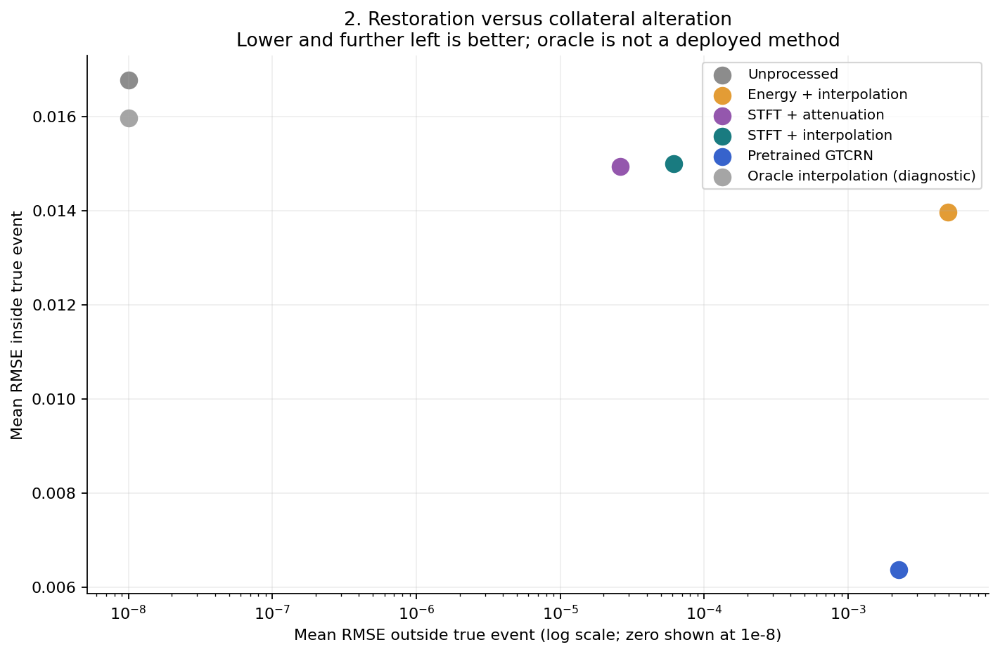

# Sparse Impulsive-Noise Removal: Classical Detection and Repair versus Neural Speech Enhancement

**Leona Wang · SID 540686380 · ELEC5305**

> For sparse impulsive interference, should processing also be sparse? We compare transparent event detection and local repair with official pretrained GTCRN, measuring restoration, collateral alteration and computation separately.

## Start here

Open [the main experiment notebook](notebooks/impulsive_noise_project.ipynb) for a guided, executable walkthrough. Read [the technical report](report/final_report.pdf) for the full analysis. Supporting modules and generated measurements are organised below; the notebook is the main entry point.

## Experiment

- Controlled generator: clean reference, two synthetic and three ESC-50 event templates, exact insertion intervals and masks.
- Energy-only baseline and STFT energy/flux/bandwidth detector; thresholds chosen only on development clips.
- Local attenuation/interpolation, official pretrained DNS3 GTCRN, and diagnostic oracle interpolation.
- 90 development mixtures, 180 held-out mixtures, 20 seconds of clean no-op tests.
- Five requested result figures, supplementary spectrograms, locally generated listening examples, CSV measurements and technical report.

The original benchmark uses one Open Speech Repository recording. The extension uses speaker- and prompt-disjoint L2-ARCTIC utterances, three new ESC-50 templates and a separate check using manually annotated stop-consonant intervals.

## Speaker-disjoint results

On 1,728 mixtures from three held-out speakers, event F1 was 0.084 for the original STFT detector, 0.154 after retuning STFT, and 0.475 for the short-context detector.

| Detector | Precision | Recall | F1 | Sample recall | Clean false events |
| --- | --- | --- | --- | --- | --- |
| Energy (original threshold) | 0.066 | 0.203 | 0.100 | 0.103 | 70 |
| STFT (original threshold) | 0.206 | 0.053 | 0.084 | 0.011 | 6 |
| STFT (retuned) | 0.127 | 0.194 | 0.154 | 0.049 | 33 |
| Short-context detector | 0.466 | 0.484 | 0.475 | 0.212 | 14 |

See [the technical report](report/final_report.md) for restoration, runtime, weak-event misses, and the annotated /p/, /t/ and /k/ comparison.

## Original benchmark results

| Detector | Precision | Recall | F1 | TP / FP / FN | Mean matched onset error (ms) |
|---|---:|---:|---:|---|---:|
| ENERGY | 0.047 | 0.289 | 0.080 | 52 / 1062 / 128 | 3.77 |
| STFT | 0.521 | 0.278 | 0.362 | 50 / 46 / 130 | 2.76 |


| Method | Event RMSE | Clean-region RMSE | Event error reduction (dB) | SI-SDR (dB) | STOI | Median RTF |
|---|---:|---:|---:|---:|---:|---:|
| Unprocessed | 0.016776 | 0.000000 | 0.00 | 32.95 | 0.971 | 0.00000 |
| Energy + interpolation | 0.013971 | 0.004933 | 1.25 | 12.13 | 0.877 | 0.00030 |
| STFT + attenuation | 0.014943 | 0.000026 | 0.97 | 33.77 | 0.972 | 0.00183 |
| STFT + interpolation | 0.014994 | 0.000062 | 1.15 | 33.64 | 0.974 | 0.00183 |
| GTCRN (DNS3 pretrained) | 0.006374 | 0.002243 | 5.87 | 17.89 | 0.899 | 0.01649 |


GTCRN restores the event region more strongly; the conservative STFT local methods preserve the surrounding reference better. Neither result establishes that DSP or neural enhancement is universally superior. See the [full report](report/final_report.md), [revised proposal](report/revised_proposal.md) and [case-level results](results/).



## Reproduce (Python 3.12 recommended)

```bash
git clone https://github.com/zhi0708/elec5305-project--540686380-.git
cd elec5305-project--540686380-
python3 -m venv .venv
source .venv/bin/activate
python -m pip install -r requirements.txt
python scripts/prepare_data.py
python -m pytest -q
python scripts/run_experiment.py
python scripts/prepare_extended_data.py
python scripts/run_extended_experiment.py
python scripts/plot_extended_case.py
python scripts/build_deliverables.py
python scripts/render_reports.py final_report
```

On Windows, activate with `.venv\Scripts\activate`. No GPU is needed. Preparation downloads only three ESC-50 recordings and the official GTCRN repository/checkpoint. It checks the event hashes and pins GTCRN commit `502ebfab64da7c4a9af78dcb9c6ceef1ebb01c73`. Data downloads require an internet connection. The extended preparation additionally downloads five checksum-verified L2-ARCTIC speaker archives (about 1.5 GB total) and three ESC-50 fold-2 clips. The corpus archives stay local. Measurements exclude first-call model warm-up and loading. The tested software/hardware and checkpoint hash are in [summary.json](results/summary.json). Hardware-specific RTFs may change on your machine; deterministic signal metrics should agree within normal numerical tolerance.

## Process your own recording

```bash
python scripts/enhance.py input.wav output.wav --method stft --repair interpolate
python scripts/enhance.py input.wav output_gtcrn.wav --method gtcrn
python scripts/enhance.py input.wav output_transient.wav --method transient
```

Local output also includes a JSON file of predicted sample intervals. Ground truth is not used. Thresholds are specific to this experiment and are not a validated general-purpose setting.

## Export a reproducible controlled input

```bash
python scripts/export_case.py clip3_synthetic_20ms_steady_voiced_+6dB
```

This writes clean.wav, noise.wav, noisy.wav, event_mask.npy and metadata.json. All 270 case IDs/intervals are listed in [case_manifest.json](results/case_manifest.json). A full run also generates three compact NPZ examples with exact floating-point signals and true masks; these derived binary files are not committed. The website examples use a separate fixed-amplitude experiment: precisely the same event samples are moved among three locations.

## Website and submission

- Main notebook: [notebooks/impulsive_noise_project.ipynb](notebooks/impulsive_noise_project.ipynb). Use the same file across updates.
- Listening examples and a short demonstration video are available on the project website.
- Website source: [docs/index.html](docs/index.html). Preview locally: `python -m http.server 8000 --directory docs`.
- Intended public URL: https://zhi0708.github.io/elec5305-project--540686380-/
- [GitHub Actions workflow](.github/workflows/pages.yml) publishes `docs/` after an authorised push to main. In Settings → Pages, select **GitHub Actions** if needed. A deployment is only live after the workflow succeeds; verify the public URL before submitting.
- Existing `audio_exploration` is retained as the original initial experiment.

## Files

| Path | Purpose |
|---|---|
| notebooks/impulsive_noise_project.ipynb | Main experiment walkthrough, controls, recorded results and interpretation |
| src/dsp.py | Transparent features, detectors, exact support masks, local repair, metrics |
| src/neural.py | Official model adapter with modern complex STFT handling |
| scripts/prepare_data.py | Reproducible dataset/model setup |
| scripts/run_experiment.py | Frozen-threshold experiment and no-op controls |
| scripts/make_figures.py | Five measured result figures and supplementary spectrograms |
| results/ | Manifest, threshold search, per-case and grouped measurements, example arrays |
| report/ | English report, revised 700-1000 word proposal and submission description |
| docs/ | Static website, figures, audio examples and demonstration |
| tests/ | Ground-truth integrity, preservation and one-to-one scoring tests |

## Data provenance and attribution

Speech is `OSR_us_000_0010_8k.wav` from the [Open Speech Repository](https://www.voiptroubleshooter.com/open_speech/american.html). The inherited file is byte-identical to a public mirror of that file; its SHA-256 and verification details are in [data/speech_manifest.json](data/speech_manifest.json). OSR permits copying, modification and website incorporation with source attribution. It is a controlled reference, not certified noise-free speech. ESC-50 is CC BY-NC 3.0 as a dataset; individual records and attribution appear in [data/esc50/LICENSE.txt](data/esc50/LICENSE.txt) and [manifest.json](data/esc50/manifest.json). Used originals: Robinhood76 (door knock, CC BY-NC), MegaPenguin13 (trackpad click, CC0), Anton (typing, CC BY). Raw downloaded events and GTCRN files are excluded from git and fetched by setup; no licence is asserted over third-party materials.

L2-ARCTIC: [corpus and annotation documentation](https://psi.engr.tamu.edu/l2-arctic-corpus-docs/), [pinned v5.0 mirror](https://huggingface.co/datasets/chikingsley/l2-arctic-release-v5.0/tree/cc02fd37197966e5de11ad737f7affd577c61992). Additional ESC-50 recordings: GodofPH (knock, CC0), esperri (mouse, CC0), SpazTastic (typing, CC Sampling+). Only derived numerical results are distributed for these new sources.

## Academic and technical references

1. S. V. Vaseghi and P. J. W. Rayner, "Detection and suppression of impulsive noise in speech communication systems," IEE Proceedings I, vol. 137, no. 1, pp. 38-46, 1990.
2. R. C. Nongpiur and D. J. Shpak, "Impulse-noise suppression in speech using the stationary wavelet transform," JASA, vol. 133, no. 2, pp. 866-879, 2013. https://doi.org/10.1121/1.4773264
3. C. Medina, R. Coelho and L. Zao, "Impulsive noise detection for speech enhancement in HHT domain," IEEE/ACM TASLP, vol. 29, pp. 2244-2253, 2021. https://doi.org/10.1109/TASLP.2021.3086131
4. X. Rong, T. Sun, X. Zhang, Y. Hu, C. Zhu and J. Lu, "GTCRN: A Speech Enhancement Model Requiring Ultralow Computational Resources," ICASSP 2024. https://doi.org/10.1109/ICASSP48485.2024.10448310. Official implementation: https://github.com/Xiaobin-Rong/gtcrn
5. L. Zhou, H. Liu, L. Gan, Y. Zhou, M. Niedzwiecki and T.-K. Truong, "A novel sparse adaptive filter for suppressing impulsive disturbance in audio signals," Signal Processing, vol. 241, article 110390, April 2026. https://doi.org/10.1016/j.sigpro.2025.110390. Author code/data: https://github.com/minikatty/Lq_JSLMP
6. K. J. Piczak, "ESC: Dataset for Environmental Sound Classification," ACM Multimedia, 2015. Dataset and attribution: https://github.com/karolpiczak/ESC-50
7. C. H. Taal et al., "An Algorithm for Intelligibility Prediction of Time-Frequency Weighted Noisy Speech," IEEE TASLP, 2011. STOI implementation: https://github.com/mpariente/pystoi
8. G. Zhao et al., "L2-ARCTIC: A Non-native English Speech Corpus," Interspeech 2018, pp. 2783–2787. https://doi.org/10.21437/Interspeech.2018-1110


## Acknowledgement

AI assistance was used for implementation and documentation. The displayed results come from executing the supplied code; pretrained model performance is measured here rather than copied from its authors' benchmark.
