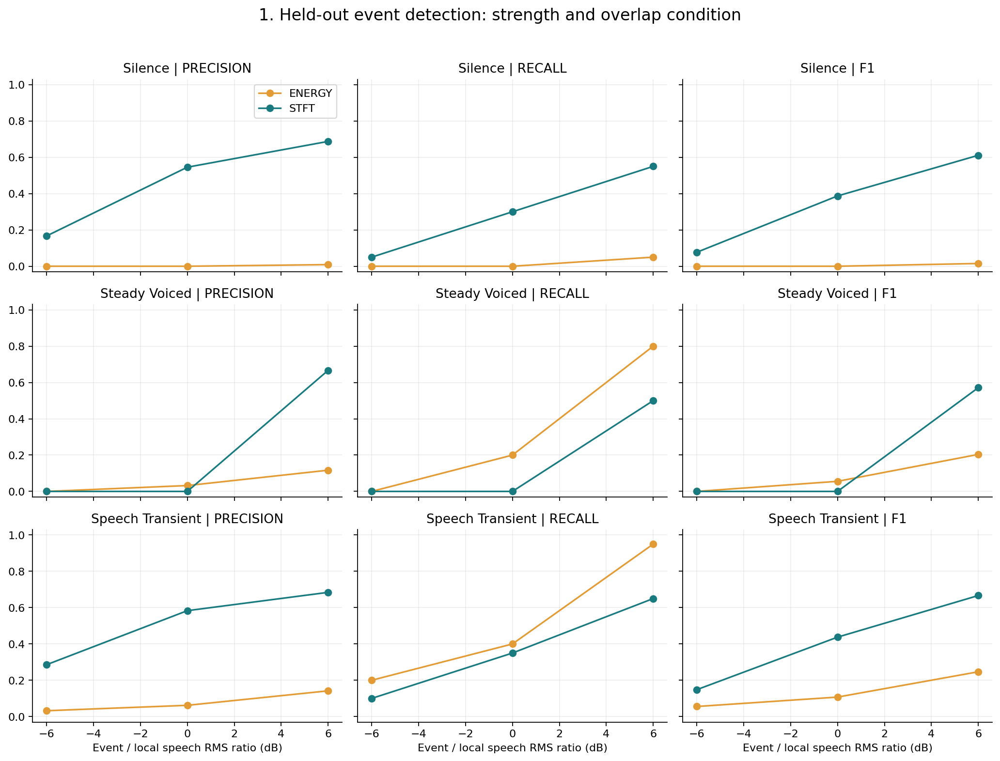
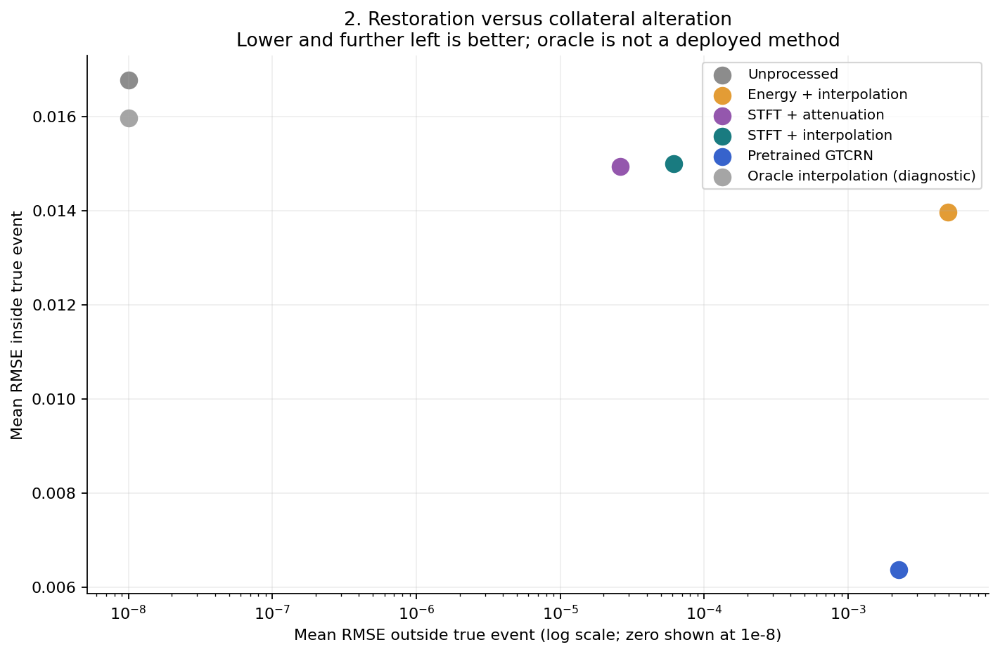
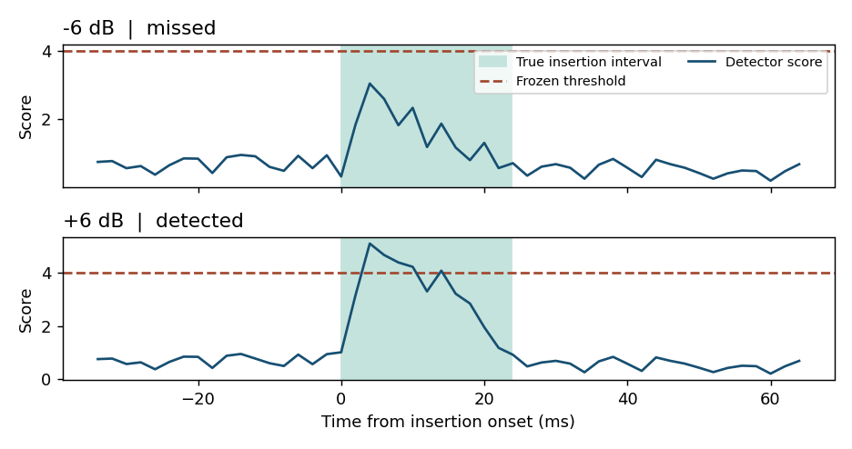

# Sparse Impulsive-Noise Removal: Classical Detection and Repair versus Neural Speech Enhancement

Leona Wang | SID 540686380 | GitHub: zhi0708 | ELEC5305

[GitHub code repository](https://github.com/zhi0708/elec5305-project--540686380-)

[GitHub Pages project website](https://zhi0708.github.io/elec5305-project--540686380-/)

## Abstract

A mouse click can interrupt a word while leaving the rest of the recording clear. This project compares repairing the detected part of the signal with processing the entire recording using pretrained GTCRN. The first experiment uses 90 development mixtures and 180 test mixtures with known noise locations. STFT detection raised event F1 from 0.080 to 0.362, although many events were missed. On 1,728 mixtures from three held-out speakers, event F1 was 0.084 for the original STFT detector, 0.154 after retuning STFT, and 0.475 for the short-context detector. GTCRN reduced more error inside the noisy intervals. Local repair changed less of the surrounding speech and took less time on the same CPU.

## 1. Research question and motivation

A short click in a lecture recording can cover part of a word. If the rest of the recording is clear, one option is to locate the click and repair only that interval. This depends on the detector being able to tell a click from a sudden change in speech. A neural speech enhancer can process the whole recording, including the parts that were already clear. The research question is how these approaches compare in the amount of error they remove from the noisy interval, the changes they make elsewhere, and the time they take to run.

## 2. Literature Review

### 2.1 Detecting and repairing sparse interference

Vaseghi and Rayner [1] use speech prediction to find samples that are difficult to explain from their neighbours. Prediction also offers a way to reconstruct the damaged samples. It depends on nearby speech providing a useful model of what was lost. Stationary-wavelet suppression [2] examines changes at several scales, and the Hilbert-Huang transform method [3] uses a representation adapted to the signal. The STFT gives this project a simpler way to inspect when the spectrum changes and how broadly its energy spreads. A stop-consonant release can still show both features, which is why the experiment includes clean speech and separately tests annotated stops.

Zhou et al. [5] study filters that account for impulsive disturbances being concentrated in a small part of the signal. Here, the known insertion interval makes it possible to check how much a method changes outside that part. Detection and repair are tested separately. If interpolation still makes an error when given the true interval, the error can arise from the repair itself even when the position is known.

### 2.2 General neural enhancement and evaluation

GTCRN [4] uses grouped temporal convolution and recurrence for speech enhancement. The authors provide a pretrained DNS3 checkpoint, which allows the comparison to use the same mixtures and CPU as the local methods. The model enhances the whole signal. Its training for general speech enhancement leaves open how well it handles a brief click. The experiment therefore compares each output with the reference both inside and outside the insertion. STOI [7] gives an additional estimate of intelligibility over the full recording.

Spectral flux describes the change between two neighbouring spectra. The detector uses it to find sudden changes, but the original version also responded to a sharp spectral change at low energy. An event mask records which samples the repair can change. The real-time factor (RTF) records how long processing takes relative to the length of the clip.

## 3. Data and controlled corruption

The existing repository contains one 33.62-second, mono 8 kHz speech recording. It is OSR_us_000_0010_8k.wav from the Open Speech Repository, verified against a byte-identical public mirror. Its source and SHA-256 are recorded in data/speech_manifest.json. It is treated as a controlled reference rather than a certified noise-free corpus. Only the first 30 seconds are used. They form six non-overlapping five-second clips: clips 1-2 are development data and clips 3-6 are test data. The split separates time segments, not speakers. Upsampling to 16 kHz meets GTCRN's input requirements but does not restore missing bandwidth. All speech clips share one fixed scaling that limits the original recording peak to 0.15; mixtures and outputs are never independently normalised.

Two synthetic templates are seeded Gaussian bursts with Hann envelopes, lasting 5 and 20 ms. Three real templates are cropped from ESC-50 [6]: door knock (31.375 ms), mouse click (16.125 ms) and keyboard event (18.312 ms). A 2 ms RMS envelope locates the strongest peak; the crop expands while above 10% of peak, with a 75 ms limit on each side, 2 ms guards and short boundary fades. Source files, crop times, individual attribution and file hashes are provided. There is only one extracted template per real class, so this tests three examples rather than environmental-event diversity.

Each template is added separately at a pause, a steady voiced candidate and a speech-transient candidate. Locations are derived from the reference waveform: minimum smoothed energy identifies the pause; autocorrelation with an energy gate and low-flux preference identifies steady voiced speech; large positive spectral flux identifies the transient. These are acoustic proxies, not human-verified vowels or phoneme-aligned /p/, /t/ and /k/ releases. The reference is used for constructing controlled cases and evaluating outputs, never supplied to a tested detector.

Event levels are -6, 0 and +6 dB. Level means event RMS relative to the RMS of a local speech window extending 50 ms on each side of the inserted interval. In near silence, that reference has a floor at 10% of whole-clip RMS. An insertion mask covers the exact half-open interval [start, end), including its fades. The generator retains clean speech, added event, corrupted speech and the mask. All case intervals are saved in the manifest; scripts/export_case.py materialises any case. Float arrays are used for measurements to avoid clipping or quantisation. The grid contains 2 x 5 x 3 x 3 = 90 development mixtures and 4 x 5 x 3 x 3 = 180 test mixtures. These are controlled variants of a small reference, not 270 independent utterances.

## 4. Detection and local restoration

The analysis uses 8 ms windows and 2 ms hops, with a Hann window for spectra and a 256-point real FFT. Short frames favour transient timing; zero padding samples the spectrum more densely but does not increase physical frequency resolution. Short windows improve temporal localisation at the expense of frequency discrimination. Energy describes local intensity, spectral flux captures positive frame-to-frame spectral change, and bandwidth describes spectral spread. Suppression is evaluated separately from speech preservation; LPC reconstruction remains a possible extension.

The energy baseline compares a local energy rise against a threshold. Its rise is 10 log10((frame_energy + floor)/(local_median_energy + floor)). The median spans 101 frames, approximately 202 ms; the floor is 1% of the recording's 60th-percentile frame energy. This adaptive baseline can detect sudden increases but can mistake normal speech onsets for interference. Its runtime excludes all FFT calculations.

The STFT method combines three features: positive energy rise, positive spectral flux and spectral bandwidth. Flux is the sum of squared positive changes between consecutive L2-normalised magnitude spectra. Its robust z-score uses the recording median and a scale equal to the maximum of 1.4826 times the median absolute deviation, 0.1 times its standard deviation, and a numerical floor. Bandwidth is the square root of the power-weighted frequency variance. The score is max(energy_rise,0)/6 + max(flux_z,0)/3 + bandwidth/1500. The coefficients are fixed heuristic scales, not learned from test labels. Their benefit is interpretability; no ablation is available to isolate each feature's contribution.

Candidate frames exceeding the threshold are mapped to sample intervals, including the frame's half-window support. Candidates longer than 150 ms are rejected. The same duration rule applies to both detectors. The development search considers seven energy thresholds and eight STFT thresholds. It maximises event F1 with false events on the two clean development clips counted 45 times, giving each clean clip the same weight as its 45 noisy variants. This makes preservation an explicit selection preference. The frozen thresholds are 9 dB energy rise and STFT score 5. The test set is not used to choose either threshold.

Attenuation applies a gain of 0.2 inside the predicted event, with up to 2 ms entry and exit ramps. Interpolation replaces the predicted samples with a straight line connecting the preceding and following samples. At file boundaries, the missing neighbour is zero. Both methods preserve the input exactly outside the predicted mask. This guarantee concerns the predicted interval; false detections can still alter genuinely clean speech. An oracle interpolation control uses the true mask solely to diagnose reconstruction limitations and is excluded from detector performance and runtime comparison.

## 5. Neural comparison and evaluation protocol

GTCRN uses the official DNS3 checkpoint, unmodified model architecture and a pinned source commit. No model is trained or fine-tuned. The adapter follows the official 512-sample FFT, 256-sample hop and square-root Hann analysis/synthesis convention. Modern PyTorch complex STFT tensors are converted into the model's real/imaginary input representation and converted back for iSTFT. Output length is explicitly matched to input length. There is no case-specific gain correction, delay fitting or reference-guided enhancement.

Event detection uses one-to-one matching of predicted and true intervals with positive overlap. TP, FP, FN, precision, recall and F1 are pooled over test cases. A partial overlap counts as an event hit, so sample-level metrics are also stored to reveal poor interval coverage. Onset error is the absolute start-time difference for matched events only; it does not summarise misses. Reports separate pause, steady voiced and transient locations, and retain event type and strength in per-case CSVs.

Event RMSE compares output with the clean reference inside the true insertion interval. Collateral RMSE uses every sample outside that true interval, thereby counting false-positive repair and any neural alteration. Event error reduction is 10 log10(noisy event MSE / output event MSE); positive values mean improvement. Whole-file SI-SDR and STOI [7] are secondary checks, not substitutes for local measurements. Table values are arithmetic means across cases; median RTF is reported separately. A mean of dB improvements is not equivalent to a dB ratio of mean errors. Clean-input preservation is evaluated over all four test clips (20 seconds) with no inserted events.

Both methods run on the same INTEL(R) XEON(R) PLATINUM 8573C CPU environment. Neural inference is CPU-only with one PyTorch thread. Model loading and one warm-up call are excluded. Local runtime includes detector computation and repair; neural runtime includes STFT, model and iSTFT. RTF is wall-clock processing time divided by five seconds of audio. It measures offline throughput, not causal latency: local median filtering and recording-wide feature normalisation use future context. No streaming implementation is claimed.

## 6. Measured results

### 6.1 Detection

| Detector | Precision | Recall | F1 | TP / FP / FN | Mean matched onset error (ms) |
|---|---:|---:|---:|---|---:|
| ENERGY | 0.047 | 0.289 | 0.080 | 52 / 1062 / 128 | 3.77 |
| STFT | 0.521 | 0.278 | 0.362 | 50 / 46 / 130 | 2.76 |

The STFT detector markedly increases precision and overall F1 but does not improve recall. Both methods miss most of the weak events. The STFT method has 130 missed events out of 180; it is a conservative detector, not a reliable general impulse remover. Its sample-level recall is only 0.087, lower than event recall, because some detections overlap only a fraction of an inserted event. Inference from event F1 alone would therefore overstate useful localisation.

| Acoustic location | Detector | Precision | Recall | F1 |
|---|---|---:|---:|---:|
| silence | energy | 0.003 | 0.017 | 0.005 |
| silence | stft | 0.545 | 0.300 | 0.387 |
| speech transient | energy | 0.080 | 0.517 | 0.139 |
| speech transient | stft | 0.579 | 0.367 | 0.449 |
| steady voiced | energy | 0.052 | 0.333 | 0.091 |
| steady voiced | stft | 0.400 | 0.167 | 0.235 |

Figure 1 shows precision, recall and F1 against strength separately for these locations. Full grouped values also separate the five event templates. The strongest performance is template-dependent: the short synthetic click and real mouse click are detected more often than the cropped knock and keyboard event. This is consistent with the chosen spectral features favouring abrupt broad-spectrum change, but without an ablation the explanation remains a hypothesis. The transient condition is not uniquely hardest in this small experiment, so the experiment does not establish consonant-overlap conditions as the most difficult category.

### 6.2 Restoration, preservation and computation

| Method | Event RMSE | Clean-region RMSE | Event error reduction (dB) | SI-SDR (dB) | STOI | Median RTF |
|---|---:|---:|---:|---:|---:|---:|
| Unprocessed | 0.016776 | 0.000000 | 0.00 | 32.95 | 0.971 | 0.00000 |
| Energy + interpolation | 0.013971 | 0.004933 | 1.25 | 12.13 | 0.877 | 0.00030 |
| STFT + attenuation | 0.014943 | 0.000026 | 0.97 | 33.77 | 0.972 | 0.00183 |
| STFT + interpolation | 0.014994 | 0.000062 | 1.15 | 33.64 | 0.974 | 0.00183 |
| GTCRN (DNS3 pretrained) | 0.006374 | 0.002243 | 5.87 | 17.89 | 0.899 | 0.01649 |

GTCRN produces the lowest measured mean event RMSE and about 5.87 dB mean event error reduction, compared with 1.15 dB for STFT interpolation. However, STFT interpolation has far lower collateral RMSE (0.000062 versus 0.002243) and preserves global speech metrics more closely. GTCRN's mean whole-file STOI is lower than the unprocessed sparse-corruption input despite better local event repair. This shows why event removal alone does not establish whole-speech benefit. It may also reflect domain mismatch: the reference originates at 8 kHz and is upsampled, whereas the model is a general 16 kHz enhancer. The experiment cannot isolate domain mismatch from learned processing effects.

The energy baseline has particularly high collateral error because its false events repair many legitimate speech intervals. Locality alone does not guarantee preservation if the detector is wrong. STFT attenuation and interpolation yield modest average improvement and a zero median improvement: at least half of cases receive no useful repair. The oracle control yields mean event RMSE 0.015971 and mean event error reduction 2.85 dB. Even perfect event location does not guarantee that a straight line reconstructs oscillatory speech. Its event RMSE can remain large on speech overlaps despite exactly zero collateral error.

Figure 2 displays event error against collateral error. The project website includes a separate waveform and spectrogram demonstration using an identical 20 ms event and fixed absolute amplitude across three locations. Table values describe the local-RMS sweep. All measured median RTFs are below one, but this is an offline CPU result. GTCRN parameter tensors occupy 192,980 bytes; the checkpoint is 579,819 bytes. The model has 48,245 parameters including fixed ERB mappings, of which 23,669 are trainable. These are model-storage figures, not measured process peak memory; DSP stores no learned weights but does use waveform, frame and FFT work buffers.

### 6.3 Clean-input false alarms and preservation

| Method | False events / 20 s | False events / minute | Mean clean RMSE | Modified clean samples |
|---|---:|---:|---:|---:|
| Energy + interpolation | 24 | 72 | 0.00492323 | 3.5575% |
| STFT + interpolation | 1 | 3 | 0.00000564 | 0.0403% |
| GTCRN (DNS3 pretrained) | N/A | N/A | 0.00221101 | 100.0000% |

The STFT detector produces one false event over the clean test clips, versus 24 for the energy baseline. The clean false-positive figure on the project website shows the STFT false alarm in clip 6: a small waveform change coincides with a sharp normalised spectral-flux peak, rather than an unusually loud pulse. This explains how abrupt spectral evolution can cross the threshold even at low absolute energy. The waveform has not been phoneme-labelled, so the event is described as a legitimate reference-speech change, not identified as /t/ or /k/. The clean no-op test also shows that GTCRN changes almost all samples; the changes are numerically measurable, not evidence that every altered sample sounds worse. Audio examples enable informal inspection, but no formal listening study or perceptual preference claim is made.

## 7. Speaker-disjoint evaluation

### 7.1 Protocol and detector

The extension uses L2-ARCTIC v5.0 [8]. The first six manually annotated utterances in sorted order for ASI and HKK form the development set. The next eight utterance IDs for each of BWC, TLV and YDCK form the test set. Neither speakers nor prompt IDs cross the split. Waveforms are resampled from 44.1 kHz to 16 kHz and each reference is scaled once to a peak of 0.15. The reference, mixture and outputs then share that scale. In development, the original five event templates yield 540 mixtures. Testing yields 1,728 mixtures, including 648 using three additional ESC-50 recordings from fold 2. Clean controls total 120.0 seconds. These are controlled variants of 24 test utterances from three speakers.

The short-context detector measures first-difference energy in 2 ms windows. It compares this energy with the larger mean of the two flanks, approximately 20–60 ms away. This downweights rises that continue into surrounding speech. Its score combines positive flank contrast in dB (scaled by 6), positive local energy rise (scaled by 9), bandwidth (scaled by 1700 Hz), capped flux min(3 × flux, 1), and an optional low-level penalty. Development selected contrast weight 0.75, low-level penalty weight 0.0, and threshold 4.0. A threshold-only STFT control selected 4.0 from the original eight-value grid. Both searches used the same development clips and maximised event F1 with each clean false alarm weighted by 45. Test mixtures and phoneme labels did not select settings. The published energy and STFT thresholds of 9 and 5 serve as fixed transfer baselines.

### 7.2 Detection and restoration

On 1,728 mixtures from three held-out speakers, event F1 was 0.084 for the original STFT detector, 0.154 after retuning STFT, and 0.475 for the short-context detector. The short-context detector matched 837 events and missed 891, with 960 unmatched predictions. Retuned STFT matched 336 and missed 1392, with 2302 unmatched predictions. On the uncorrupted inputs, short-context detection produced 14 false events and retuned STFT produced 33.

| Detector | Precision | Recall | F1 | Sample recall | Clean false events |
| --- | --- | --- | --- | --- | --- |
| Energy (original threshold) | 0.066 | 0.203 | 0.100 | 0.103 | 70 |
| STFT (original threshold) | 0.206 | 0.053 | 0.084 | 0.011 | 6 |
| STFT (retuned) | 0.127 | 0.194 | 0.154 | 0.049 | 33 |
| Short-context detector | 0.466 | 0.484 | 0.475 | 0.212 | 14 |

| Condition | Original STFT hits | Retuned STFT hits | Short-context hits |
| --- | --- | --- | --- |
| -6 dB | 6/576 | 29/576 | 101/576 |
| +0 dB | 10/576 | 61/576 | 326/576 |
| +6 dB | 75/576 | 246/576 | 410/576 |
| silence | 24/576 | 88/576 | 213/576 |
| speech transient | 43/576 | 146/576 | 289/576 |
| steady voiced | 24/576 | 102/576 | 335/576 |
| Unseen real templates | 17/648 | 121/648 | 293/648 |

An event counts as detected as soon as the predicted interval overlaps it. Sample recall also shows how much of the event was covered. Figure 3 uses the same keyboard sound at the same point in BWC arctic a0011. At -6 dB the score stayed below threshold. At +6 dB the detector found the event but marked only 289 of its 381 samples. The unseen-template row combines results for the three extra ESC-50 recordings.

| Pipeline | Event reduction (dB) | Outside-event RMSE | SI-SDR (dB) | STOI | Median CPU RTF |
| --- | --- | --- | --- | --- | --- |
| Unprocessed | 0.00 | 0.000000 | 28.49 | 0.985 | 0.00000 |
| STFT (original) | 0.13 | 0.000120 | 27.74 | 0.985 | 0.00081 |
| STFT (retuned) | 0.37 | 0.000695 | 25.50 | 0.984 | 0.00080 |
| Short-context repair | 0.89 | 0.000500 | 26.44 | 0.988 | 0.00091 |
| GTCRN | 6.87 | 0.001684 | 23.00 | 0.974 | 0.00915 |

GTCRN achieved 6.87 dB mean event-error reduction, while short-context interpolation achieved 0.89 dB. Their mean outside-event errors were 0.001684 and 0.000500, respectively. Each CPU timing excludes model setup and one warm-up. Clean-region RMSE quantifies waveform alteration. Perceptual quality would require a listening study.

### 7.3 Manually annotated stops

The clean control checks whether each detector touches unambiguous P, T or K intervals in the corpus's manually checked phones tier. The paired insertion test uses the first eligible token of each phone per utterance and places a 20 ms burst entirely inside the phone interval, near its strongest 2 ms first-difference-energy peak. Tests use three levels per selected token. The peak is an acoustic proxy for the release time. Human annotation identifies the phone interval.

| Phone | Original hits | Original clean overlap | Retuned hits | Retuned clean overlap | Short-context hits | Short-context clean overlap |
| --- | --- | --- | --- | --- | --- | --- |
| /p/ | 5/36 | 0/28 | 13/36 | 1/28 | 27/36 | 0/28 |
| /t/ | 0/54 | 0/32 | 3/54 | 5/32 | 37/54 | 2/32 |
| /k/ | 1/42 | 3/37 | 12/42 | 8/37 | 30/42 | 1/37 |

Clean overlap is counted per token, so one false event can touch more than one token. The targeted burst results measure detector sensitivity for a single synthetic disturbance shape and the annotated subset. The utterances repeat across strength variants, and the phoneme counts differ. The experiment does not support a population-level ranking of phonemes.

## 8. Discussion and Conclusion

### 8.1 Why the two pipelines behave differently

The difference is easiest to see by measuring the noisy interval and the rest of the clip separately. On the held-out speakers, mean error reduction in the event was 6.87 dB for GTCRN and 0.89 dB for local interpolation. Outside the event, the RMSE was 0.001684 for GTCRN and 0.000500 for local repair. GTCRN estimates an enhanced signal throughout the recording [4], whereas the local method leaves the input untouched outside its predicted mask. Even with the true mask, a straight line can miss the oscillations of voiced speech. This gives a reason to test a repair based on speech prediction [1] while keeping the mask fixed. The smaller changes outside the event are consistent with the motivation for sparse processing [5].

### 8.2 What the detector change contributed

The keyboard example in Figure 3 shows how noise can survive the local method. The score stayed below the threshold at -6 dB. At +6 dB it crossed the threshold, but the predicted interval still missed part of the insertion. Retuning the old STFT threshold gave F1 0.154, and changing the score gave 0.475 on the same test set. The comparison supports the combined change to the score. It does not show how much each feature contributed. On clean speech, the original STFT still produced fewer false events than the short-context detector (6 versus 14). The improved detection rate therefore comes with a cost relative to the original conservative setting.

### 8.3 Scope and next experiment

For these recordings, GTCRN repaired more of the noise interval. The local method ran faster and changed less of the speech around it. This conclusion is based on three test speakers and six real disturbance recordings. Several mixtures reuse the same speech and noise, so the number of mixtures is larger than the number of independent recordings. The annotated test locates /p/, /t/ and /k/ intervals and uses a peak as an estimate of release timing. It measures detection in those intervals. A listening test would be needed to tell whether people prefer either output.

A focused next experiment would hold the predicted mask fixed and compare interpolation with prediction-based reconstruction [1] on voiced overlaps. Evaluating each method with both true and predicted masks would distinguish gains in repair from errors in localisation. Testing on additional speakers and event recordings would then check whether the result survives changes in source material.

## 9. Reproduction and implementation acknowledgement

Use the README commands to set up dependencies and reproduce both benchmarks. Run scripts/prepare_extended_data.py and scripts/run_extended_experiment.py for the speaker-disjoint evaluation before rebuilding the deliverables. The run creates manifest intervals, frozen thresholds, per-case detection/restoration results, no-op tests, figures and exact example arrays. scripts/export_case.py exports any controlled input; scripts/enhance.py processes a user-supplied WAV without reference labels. See README for platform-specific environment and website instructions.

AI assistance was used in code implementation and documentation. Reported measurements were produced by executing the accompanying experiment code, not taken from expected outcomes or substituted from published GTCRN benchmark numbers.

## References

1. S. V. Vaseghi and P. J. W. Rayner, "Detection and suppression of impulsive noise in speech communication systems," IEE Proceedings I, vol. 137, no. 1, pp. 38-46, 1990.
2. R. C. Nongpiur and D. J. Shpak, "Impulse-noise suppression in speech using the stationary wavelet transform," JASA, vol. 133, no. 2, pp. 866-879, 2013. https://doi.org/10.1121/1.4773264
3. C. Medina, R. Coelho and L. Zao, "Impulsive noise detection for speech enhancement in HHT domain," IEEE/ACM TASLP, vol. 29, pp. 2244-2253, 2021. https://doi.org/10.1109/TASLP.2021.3086131
4. X. Rong, T. Sun, X. Zhang, Y. Hu, C. Zhu and J. Lu, "GTCRN: A Speech Enhancement Model Requiring Ultralow Computational Resources," ICASSP 2024. https://doi.org/10.1109/ICASSP48485.2024.10448310. Official implementation: https://github.com/Xiaobin-Rong/gtcrn
5. L. Zhou, H. Liu, L. Gan, Y. Zhou, M. Niedzwiecki and T.-K. Truong, "A novel sparse adaptive filter for suppressing impulsive disturbance in audio signals," Signal Processing, vol. 241, article 110390, April 2026. https://doi.org/10.1016/j.sigpro.2025.110390. Author code/data: https://github.com/minikatty/Lq_JSLMP
6. K. J. Piczak, "ESC: Dataset for Environmental Sound Classification," ACM Multimedia, 2015. Dataset and attribution: https://github.com/karolpiczak/ESC-50
7. C. H. Taal et al., "An Algorithm for Intelligibility Prediction of Time-Frequency Weighted Noisy Speech," IEEE TASLP, 2011. STOI implementation: https://github.com/mpariente/pystoi
8. G. Zhao et al., "L2-ARCTIC: A Non-native English Speech Corpus," Interspeech 2018, pp. 2783–2787. https://doi.org/10.21437/Interspeech.2018-1110

